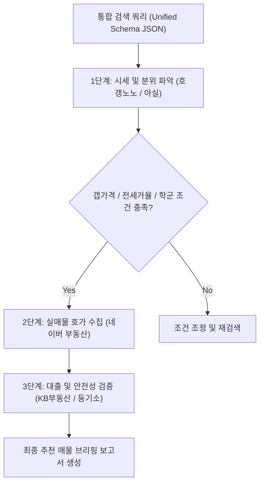

# 국내 주요 부동산 플랫폼 사이트별 활성 항목 매핑 계획 (Activation Plan)

본 문서는 부동산 통합 검색 및 자동화(ego-browser, 크롤러 등) 시스템 구축을 위해, 앞서 정의된 **부동산 종합 선택항목 스키마(Unified Real Estate Search Schema)**의 각 속성이 국내 주요 부동산 사이트에서 어떻게 활성화되고 매핑되는지를 정의한 실행 명세서입니다.

---

## 1. 종합 스키마 대비 사이트별 활성 항목 매트릭스 (Capability Matrix)

> **범례**:
> - **● (Full / 완전 지원)**: 사이트 UI에서 직접 필터링 및 조건 검색 가능
> - **▲ (Partial / 부분 지원)**: 간접 지원, 텍스트 검색 또는 상세 페이지 진입 후 개별 확인 가능
> - **- (None / 미지원)**: 해당 사이트에서 지원하지 않거나 취급하지 않는 속성

| 스키마 대분류 | 세부 필드 (Schema Field) | 네이버 부동산 | 호갱노노 | 아실 | KB 부동산 | 직방 / 다방 | 밸류맵 / 디스코 | 법원경매정보 |
| :--- | :--- | :---: | :---: | :---: | :---: | :---: | :---: | :---: |
| **1. 위치 (Location)** | 시·도 / 시·군·구 / 읍·면·동 | ● | ● | ● | ● | ● | ● | ● |
| | 지번 / 번지수 (Jibun) | ▲ | - | - | ▲ | - | ● | ● |
| | 지하철역 / 역세권 (Subway) | ● | ● | ▲ | ● | ● | - | - |
| | 지도 뷰포트 좌표 (Bounds) | ● | ● | ● | ● | ● | ● | - |
| **2. 유형 (Property)** | 아파트 (Apartment) | ● | ● | ● | ● | ● | ▲ | ● |
| | 오피스텔 (Officetel) | ● | ▲ | - | ● | ● | ▲ | ● |
| | 빌라 / 연립 / 다세대 | ● | - | - | ● | ● | ▲ | ● |
| | 원룸 / 다가구 / 주택 | ● | - | - | - | ● | ▲ | ● |
| | 상가 / 점포 / 사무실 | ● | - | - | - | ▲ | ● | ● |
| | 토지 / 임야 / 공장 | ● | - | - | - | - | ● | ● |
| | 재개발 / 분양권 | ● | ● | ● | ● | ▲ | ▲ | - |
| **3. 거래 및 가격** | 매매 / 전세 / 월세 / 단기 | ● | ▲(실거래) | ▲(실거래) | ● | ● | ▲(실거래) | - |
| | 경매 (최저입찰가 / 유찰) | - | ▲ | ▲ | - | - | ▲ | ● |
| | 매매가 / 감정가 범위 | ● | ● | ● | ● | ● | ● | ● |
| | 전세보증금 / 월세 범위 | ● | ● | ● | ● | ● | - | - |
| | 관리비 범위 (Maintenance) | ▲ | - | - | - | ●(다방) | - | - |
| | 상가 권리금 유무 | ▲ | - | - | - | - | - | - |
| **4. 물리적 스펙** | 전용면적 / 공급평형 | ● | ● | ● | ● | ● | ● | ● |
| | 연식 (사용승인일 / 준공) | ● | ● | ● | ● | ▲ | ● | - |
| | 단지 세대수 (300/500/1000+) | ● | ● | ● | ● | ▲ | - | - |
| | 층수 조건 (저층제외, 탑층) | ● | ▲ | ▲ | ▲ | ● | ▲ | ▲ |
| | 방/욕실 수, 주차대수, EV | ● | ▲ | ▲ | ▲ | ● | ▲ | ▲ |
| **5. 금융 및 투자** | 청년/버팀목 전세대출 가능 | - | - | - | - | ●(직/다) | - | - |
| | 전세가율 (%) | ▲ | ● | ● | ● | - | - | - |
| | 갭금액 (매매-전세 차이) | ▲ | ● | ● | ● | - | - | - |
| | 은행 대출한도/금리 연동 | ▲ | - | - | ● | - | - | - |
| **6. 입지 및 환경** | 초등학교 배정구역 (학군) | ● | ● | ● | ▲ | - | - | - |
| | 학원가 / 학업성취도 랭킹 | - | ● | ● | - | - | - | - |
| | 3D 일조량 / 일조시간 | - | ● | - | - | ●(직방) | - | - |
| | 주요 직장 통근 소요시간 | - | ● | - | ▲ | - | - | - |
| **7. 특화 영역** | 용도지역 / 지목 / 도로접면 | ▲ | - | - | - | - | ● | ▲ |
| | 건축 가설계(건폐·용적률) | - | - | - | - | - | ●(밸류맵) | - |
| | 특수권리 제외 / 유찰횟수 | - | - | - | - | - | - | ● |

---

## 2. 플랫폼별 상세 활성화 계획 (Site-Specific Activation Details)

### 2.1. 네이버페이 부동산 (Naver Real Estate)
- **주요 역할**: 실매물(호가) 탐색, 공인중개사 등록 매물 검증, 평형별 최저 호가 확인
- **URL**: `https://land.naver.com/`
- **활성 필터 매핑**:
  ```yaml
  Location: 시도 > 시군구 > 읍면동 (드롭다운 및 지도 줌)
  PropertyType: 아파트, 오피스텔, 빌라, 원룸, 상가, 토지 등 다중 선택
  Transaction: 매매 / 전세 / 월세 / 단기
  Price: 가격 슬라이더(최소~최대 만원 단위)
  Specs: 면적(평형대), 세대수(300/500/1000세대 이상), 사용승인일(5/10/15/20/30년 이내), 층수(저층 제외 등), 방향
  Environment: 초등학교 통학구역 레이어, 지하철역 도보 5/10/15분 반경
  ```
- **UI 조작 주의점**: 상단 고정 필터 바에서 카테고리 전환 시 서브 필터 드롭다운이 동적으로 재렌더링됨.

---

### 2.2. 호갱노노 (Hogangnono)
- **주요 역할**: 가격 통계 지도화, 갭가격 분석, 일조량 시뮬레이션, 거주민 리뷰 검증
- **URL**: `https://hogangnono.com/`
- **활성 필터 매핑**:
  ```yaml
  Location: 지도 기반 뷰포트 바운드 + 지역 검색창
  Price & Metrics:
    - 평당가격 / 실거래가 / 매물가 / 전세가율 / 갭가격 필터
    - 기간별 가격 변동률(상승/하락), 신고가 경신 필터
  Specs: 평형대(10평대, 20평대, 30평대, 40평대+), 세대수, 입주연차
  Overlays:
    - 3D 일조량 (시간대별 동/호수 그림자 분석)
    - 학원가 밀집도, 중/고교 학업성취도 및 특목고 진학률
    - 재건축/리모델링 진행 단계 필터
    - 직주근접(주요 업무지구까지 대중교통 이동시간)
  ```

---

### 2.3. 아실 (Asil - 아파트실거래가)
- **주요 역할**: 과거 실거래가 시계열 분석, 다중 단지 1:1 비교, 지역별 공급/수요(입주물량)
- **URL**: `https://asil.kr/`
- **활성 필터 매핑**:
  ```yaml
  Location: 상단 지역 드롭다운 (시도 > 시군구 > 읍면동)
  Analysis Tabs:
    - 최고가 / 하락액 순위 리스트
    - 갭투자 단지 순위 (매매-전세 차이 오름차순)
    - 매물 증감 추이 (매매/전세/월세 재고량)
    - 입주 물량 (연간 적정 수요 대비 입주 예정 아파트)
    - 아파트 비교 (최대 5개 단지 실거래가 추이 동시 중첩 비교)
    - 외지인 거래량 (지역 외 투자자 유입 비율)
  ```

---

### 2.4. KB부동산 (KB Land)
- **주요 역할**: 대출 한도 산정 기준인 KB시세 확인, 은행 대출/세금 시뮬레이션
- **URL**: `https://kbland.kr/`
- **활성 필터 매핑**:
  ```yaml
  Location: 지역 선택 (시도 > 시군구 > 읍면동)
  KB Metrics: 상위평균가 / 일반평균가 / 하위평균가 구분
  Special Filters:
    - '꿀시세' (KB시세 대비 저렴한 급매물)
    - '꿀전세' (전세가율 낮고 안전한 전세)
  Finance: 단지/평형 선택 즉시 주택담보대출 한도·금리 산출 및 취득세/재산세 계산
  ```

---

### 2.5. 직방 / 다방 (Zigbang / Dabang)
- **주요 역할**: 청년층 전월세, 원룸·투룸·빌라 탐색, 정책 대출(중기청/버팀목) 매물 필터
- **활성 필터 매핑**:
  ```yaml
  Location: 지하철역, 대학교명, 법정동 기준 검색
  PropertyType: 원룸, 투룸, 쓰리룸+, 빌라, 오피스텔
  Finance Loans:
    - 중기청(중소기업청년) 100% / 80% 가능 매물 체크박스
    - 버팀목 전세자금대출, 카카오뱅크 대출 가능 매물
    - 보증보험(HUG/SGI) 가입 가능 여부
  Options: 주차 가능, 반려동물 가능, 엘리베이터, 단기임대, 분리형 원룸
  3D View: 직방 3D 단지투어 (단지 내부 뷰 및 창밖 뷰)
  ```

---

### 2.6. 밸류맵 / 디스코 (ValueMap / Disco)
- **주요 역할**: 토지, 단독/다가구, 꼬마빌딩, 상가주택, 공장 실거래가 및 건축 규제 분석
- **활성 필터 매핑**:
  ```yaml
  Location: 지번(번지수), 도로명주소, 지도 필지 단위 클릭
  PropertyType: 토지, 단독·다가구, 근린생활시설(빌딩), 상가, 공장·창고
  Land Specs:
    - 지목 (대, 임야, 전, 답, 잡종지 등 28개 지목)
    - 용도지역 (제1·2·3종일반주거, 준주거, 상업지역, 자연녹지, 계획관리 등)
    - 도로 접면 너비 (맹지 제외, 4m/8m/12m/25m 이상)
  AI Analytics:
    - 밸류맵 기획설계 AI (건폐율·용적률 기반 신축 시 세대수/층수 가설계)
    - 디스코 등기부등본 열람 연동
  ```

---

### 2.7. 대한민국 법원 법원경매정보 (Court Auction)
- **주요 역할**: 공식 법원 부동산 경매 물건 검색 및 공문서(매각물건명세서 등) 무료 열람
- **URL**: `https://www.courtauction.go.kr/`
- **활성 필터 매핑**:
  ```yaml
  Location: 관할 지방법원/지원 지정 또는 시·도 > 시·군·구 주소 지정
  PropertyType: 아파트, 다세대, 단독주택, 상가, 대지/임야, 공장 등
  Auction Conditions:
    - 감정평가액 및 최저매각가격 범위 (원 단위)
    - 진행 상태: 신건, 유찰 (1회/2회/3회 이상)
    - 매각 기일: 입찰 기간 지정
  Documents: 매각물건명세서, 현황조사서, 감정평가서, 기일내역
  ```

---

## 3. ego-browser 자동화 및 통합 수집 실행 시나리오

통합 스키마 JSON을 기반으로 플랫폼들을 단계적으로 연계하는 추천 오케스트레이션 파이프라인입니다.



### 실행 규칙 (Automation Best Practices)
1. **사이트별 라우팅 최소화**: 목적(아파트 vs 토지 vs 경매)에 따라 2~3개 핵심 사이트로 필터링 범위를 한정하여 브라우징 속도 극대화.
2. **동적 대기(Wait) 처리**: 지도 기반 사이트(네이버 부동산, 호갱노노, 밸류맵)는 줌인 및 이동 후 클러스터 마커가 렌더링될 때까지 네트워크 유휴 상태(`networkidle`)를 확인.
3. **에러 폴백**: 특정 필터가 지원되지 않는 사이트에는 상위 호환 조건만 전달하고, 수집된 결과 데이터셋에서 후처리(Post-filtering) 적용.
